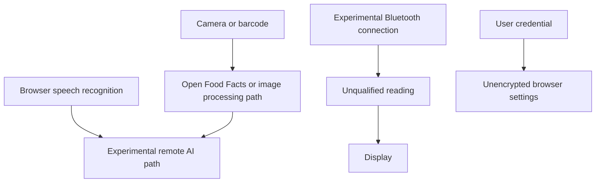

# Compagnon Diabète — DAPHNÉE OMNI · Variante expérimentale

**Legacy browser prototype · Experimental device connection · Not for medical use**

> **Avertissement critique :** la lecture Bluetooth inspectée ne décode pas de façon fiable une mesure de glycémie. Ne pas connecter de dispositif médical réel, interpréter les valeurs, commander une pompe ou déterminer un traitement avec cette version.

## Architecture constatée

| Source dans [index.html](index.html) | Comportement observé |
| --- | --- |
| `connectBT` | Demande de connexion GATT au service glycémique et lecture simplifiée d'un octet, sans décodage complet du format, des unités et des indicateurs |
| `camAction` | Quagga, recherche de code-barres Open Food Facts et chemin caméra |
| `voiceAction` | Reconnaissance vocale navigateur ; traitement réseau possible |
| `saveKey` | Stockage de la clé via safeStorage, sans chiffrement applicatif établi |
| Chemin IA | Requête Mistral expérimentale ; compatibilité et exécution non établies |

Une connexion GATT ne démontre pas une intégration de pompe. Une valeur reçue ne doit pas être affichée comme glycémie vérifiée. La clé saisie peut être stockée dans localStorage ; ne pas saisir de secret réel ni de donnée de santé. Les réponses nutritionnelles et génératives ne sont pas qualifiées médicalement.

## P0 — corrections proposées, non réalisées

Neutraliser les lectures et indicateurs médicaux non fiables, renommer le contrôle de connexion pompe, supprimer les données de démonstration trompeuses, protéger les secrets et revoir les flux de voix et d'images. Toute future intégration médicale nécessite un décodeur conforme et des essais indépendants sur données synthétiques. Aucun appareil réel ni fournisseur n'a été sollicité.

## Historique et positionnement

## Ce que fait l'application, en pratique

Le dépôt contient une déclinaison de l'interface **DAPHNÉE OMNI — ONLINE**, pensée comme **compagnon d'information sur le diabète de type 1**. Elle explore une présentation mobile, des échanges assistés et des options de connexion à des services liés au suivi.

**Statut :** variante documentaire et expérimentale. Un contrôle affiché « connexion pompe » **n'atteste d'aucune interopérabilité médicale opérationnelle** ; ne pas l'utiliser pour commander une pompe ou déterminer une dose d'insuline.

> **Statut portfolio (octobre 2026) — variante conservée, non sélectionnée dans la vitrine.** Cette version expérimentale DAPHNÉE OMNI ne figure plus dans la vitrine principale. Le prototype OPENVITA-DT1 est la référence retenue pour le suivi DT1. Aucun des deux ne remplace un professionnel de santé. Voir [la politique de sélection](https://github.com/Nikoju1977/Nikoju1977/blob/main/CURATION.md) et [le projet de référence](https://github.com/Nikoju1977/OPENVITA-DT1).

**Studio Niko Design** — Démonstrateur d'interface, non destiné aux patients.

## 🛠 Stack
`HTML` · `Mistral AI`

## 👤 Auteur
**Nicolas Julienne** — [Studio Niko Design](https://github.com/Nikoju1977)
📧 nicolasjulienne.nj@gmail.com

---

## Utilisation, périmètre et maturité

**Thème :** HealthTech — assistant d'information et de suivi.

L'interface principale se trouve dans `index.html` et peut être explorée en local via `python3 -m http.server 8000`. Les fonctionnalités liées à l'IA peuvent dépendre d'un service externe ; vérifier le code et les demandes d'autorisation avant de saisir une clé ou des données personnelles.

**Précaution médicale :** ce prototype n'est pas un dispositif de décision thérapeutique. Ne pas lui confier une décision de dosage d'insuline, ni modifier un traitement à partir de ses réponses. Vérifier le comportement réel et la confidentialité avant tout usage au-delà d'une démonstration.

**État de validation :** documentation actualisée à partir de la structure du dépôt ; aucun test d'exécution, contrôle de sécurité ou audit réglementaire n'est revendiqué.

[Voir les autres projets Studio Niko Design](https://github.com/Nikoju1977).

## English overview

This retained DAPHNÉE OMNI variant is an experimental interface, not a pump controller or reliable glucose reader. Its simplified Bluetooth parsing is not adequate for medical measurement. Browser credentials lack established encryption, and speech/image features may involve external services. Do not use real devices, credentials or patient data. No new runtime or clinical tests were performed.

[Notice de droits](LICENSE.md) : droits réservés pour les contributions originales concernées ; droits tiers préservés.
