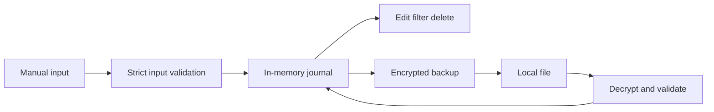

# DAPHNÉE OMNI — Journal local · Studio Niko Design

**Functional descriptive journal, not a clinical decision tool.**

[Application](https://nikoju1977.github.io/compagnon-diabete/) (déploiement de la révision non vérifié) · [Commit fonctionnel](https://github.com/Nikoju1977/compagnon-diabete/commit/a41a5043e37fdb3ceb4b39890ab54011d04381a2).

## Fonctions implémentées

- Saisie manuelle, date et unité explicites (mg/dL, mmol/L, g/L), notes, modification, suppression et filtrage.
- Historique des observations réellement saisies, sans valeurs initiales fictives.
- Sauvegarde et restauration JSON chiffrées par Web Crypto : AES-GCM 256, PBKDF2 SHA-256 (600 000 itérations), sel et IV aléatoires. Phrase secrète non enregistrée.
- Journal en mémoire : sauvegarder avant fermeture ou actualisation ; aucune persistance automatique des observations.
- Aucun envoi distant des observations, aucune clé API demandée. L'ancien stockage n'est ni lu ni supprimé automatiquement.

## Qualification

Treize assertions de validation des entrées et du format de journal ont réussi dans un environnement JavaScript lors de la création du correctif ; la source a été relue après commit. Ces assertions ne couvrent pas le navigateur, le chiffrement en exécution, le téléchargement, la restauration complète, le mobile ou le déploiement. Tester exclusivement avec des données fictives avant toute qualification. HTTPS ou localhost requis pour Web Crypto.

Les fonctions historiques de calcul de bolus, lecture Bluetooth non qualifiée, IA distante, caméra et microphone ne sont pas réactivées. Une future intégration nécessite un décodage conforme, des protections de données et une qualification indépendante. Aucun conseil thérapeutique, diagnostic ou alarme.

## English overview

Functional manual observation journal with editing, filtering, deletion and password-encrypted backup/restore code. No clinical interpretation, pump control or dose calculation. Thirteen input-validation assertions passed; browser and cryptographic end-to-end tests remain outstanding. Use synthetic data only until qualified.

[Existing rights notice](LICENSE.md) — unchanged.

## Qualification navigateur — 25 novembre 2026

La sauvegarde exige une confirmation de phrase secrète. Un avertissement navigateur est demandé avant de quitter un journal modifié en mémoire ; par prudence il subsiste après la demande de téléchargement, qui ne prouve pas que le fichier a été enregistré. Le navigateur peut ignorer cet avertissement sur mobile. La restauration validée et l'effacement le réinitialisent.

Le [test Chromium](tests/browser-journal.cjs) couvre les unités explicites, la modification, le filtrage, la suppression, les notes traitées comme texte, Web Crypto, les mots de passe, le rejet des fichiers altérés, l'annulation et la restauration, la mémoire volatile, la préservation des clés étrangères, le viewport mobile simulé et l'absence de POST. Exécuter `node tests/browser-journal.cjs` avec Node disposant de WebSocket, Chrome/Chromium et Python 3. [CI](.github/workflows/browser-journal.yml) ; résultat à vérifier. Données fictives uniquement, aucune qualification clinique ou sur appareil physique.

Le banc de test indépendant reprend le code de test [NikoAssist](https://github.com/Nikoju1977/Nikoassist/blob/main/web/browser-smoke.cjs) et [OpenVita](https://github.com/Nikoju1977/OPENVITA-DT1/blob/main/tests/browser-vault.cjs), sous GPL-3.0-or-later ; [licence](tests/LICENSE-GPL-3.0). La notice de droits du code applicatif est inchangée.
