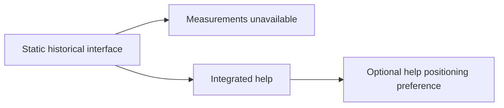

# Compagnon Diabète — DAPHNÉE OMNI · Maquette historique

**Studio Niko Design — historical non-medical interface**

> **Correctif P0 du 25 novembre 2026 :** les chemins de calcul de bolus, de lecture Bluetooth, de dialogue IA, de capture caméra et de reconnaissance vocale ont été retirés de l'entrée HTML publique. Aucune mesure ou dose n'est présentée ; aucune clé API n'est demandée. [Commit source](https://github.com/Nikoju1977/compagnon-diabete/commit/d773c0a540ac858a21898b4a1c4c27911725d4e5).

La version précédente comportait un décodage Bluetooth non qualifié, une formule de bolus non validée, des valeurs de graphique fictives et un stockage de clé non chiffré. Elle ne doit pas servir à une décision de traitement. Le code historique reste dans l'historique Git, sous sa licence existante.

## Architecture actuelle

- Maquette statique [index.html](index.html), sans moteur clinique ni connexion à un appareil médical.
- Guide intégré conservé. Aucun accès aux anciennes clés ni suppression automatique des données locales ; les données d'anciennes versions peuvent subsister.
- Aucune démonstration en production ni installation PWA n'est validée ici. Une ancienne copie téléchargée ou mise en cache peut encore contenir le code historique.

## Qualification et confidentialité

La source publiée a été relue après commit : les chemins visés ont été retirés. Aucun test navigateur, appareil physique, appel fournisseur ou validation clinique n'est revendiqué. Ne jamais utiliser la maquette pour déterminer un traitement. Avant d'effacer les données d'une origine web, tenir compte des autres applications partageant cette origine.

## English overview

The current HTML entry point is a historical, non-medical mockup. Unvalidated glucose and bolus logic, Bluetooth device access, remote AI, camera and voice paths have been removed from the entry point. No new runtime or deployment verification was performed. Old cached versions may still exist.

[Existing rights notice](LICENSE.md) — unchanged. [Studio Niko Design](https://github.com/Nikoju1977).
